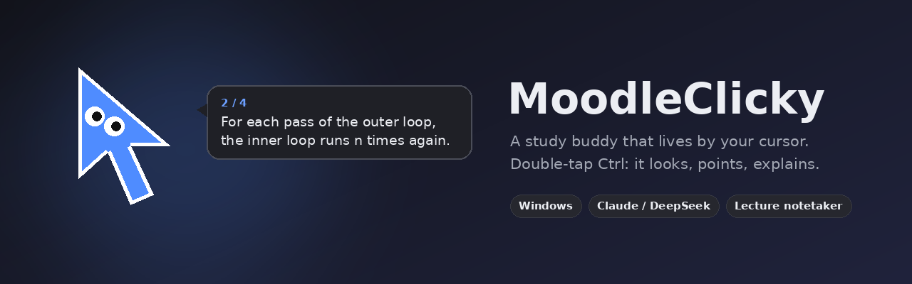
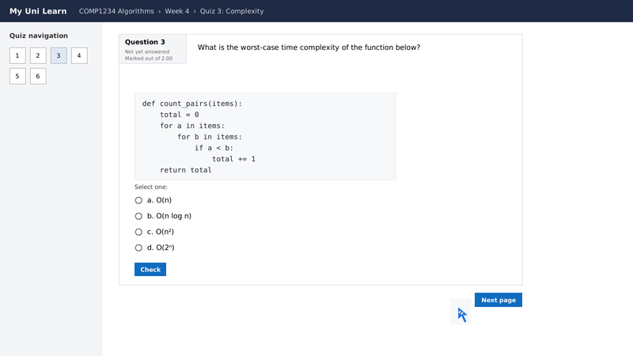
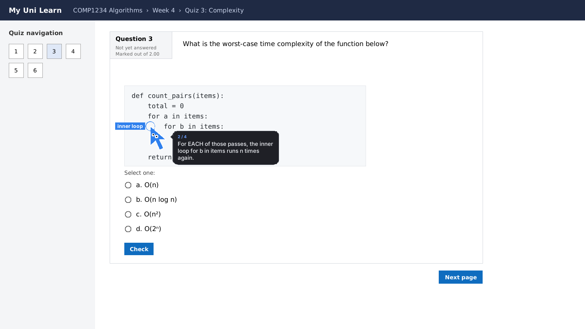
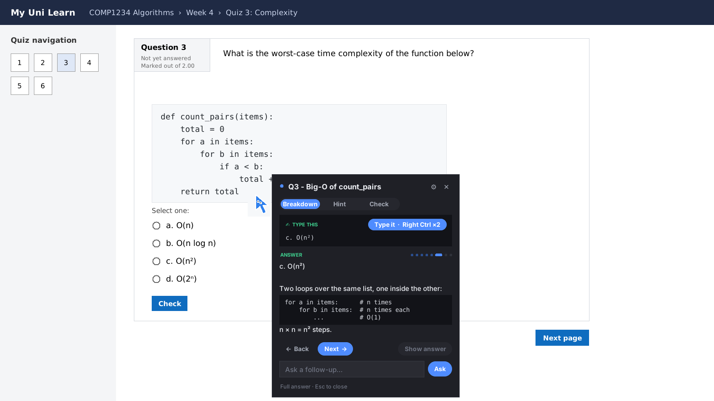
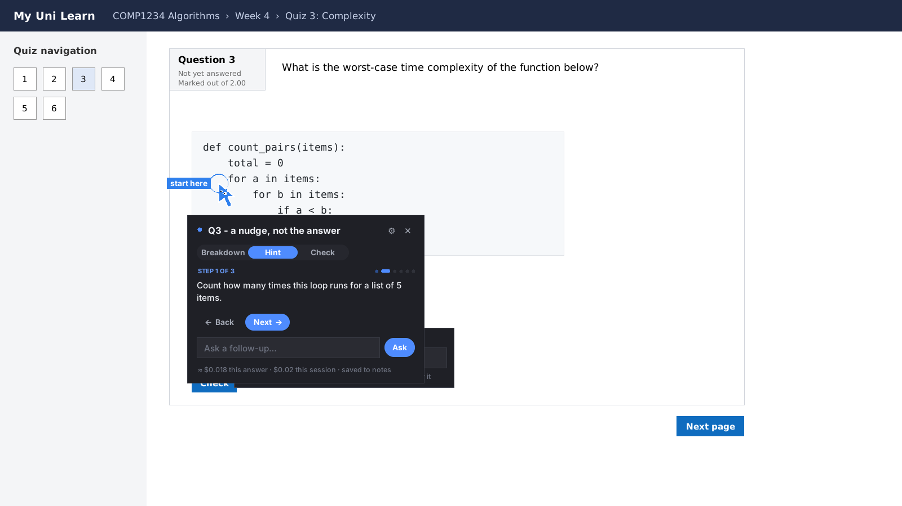
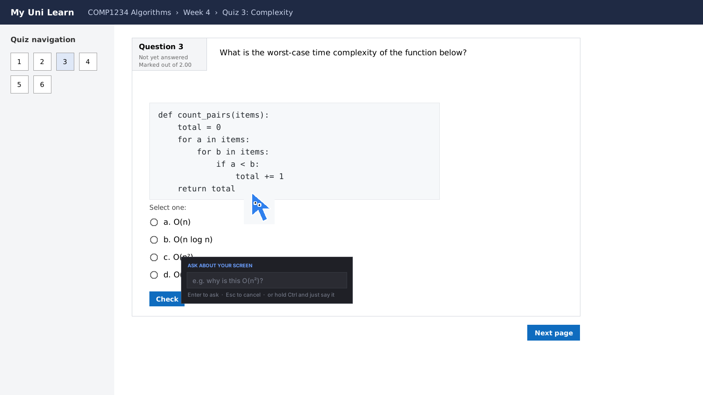
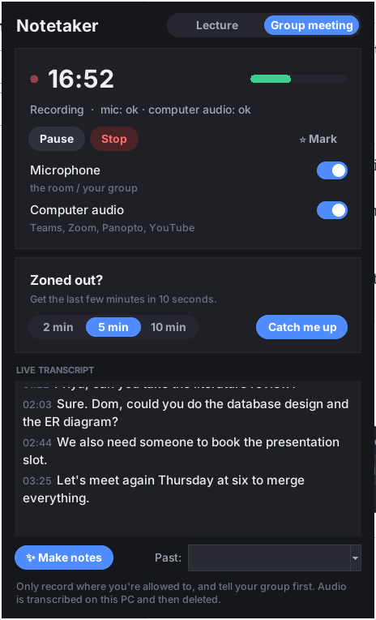
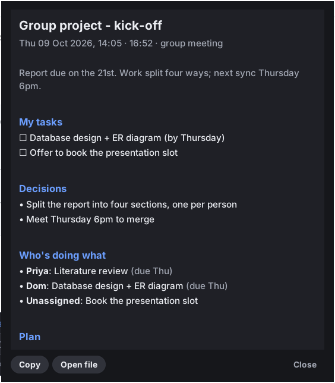

<p align="center">
  
</p>

<p align="center">
  <a href="https://github.com/WastedPatriot/MoodleClicky/actions/workflows/ci.yml"></a>
  <a href="https://github.com/WastedPatriot/MoodleClicky/releases/latest"></a>
  
  
  <a href="LICENSE"></a>
</p>

Stuck on a Moodle quiz question, a coursework task or an error in your code? **Double-tap Right Ctrl.** MoodleClicky screenshots what's under your mouse, flies its little cursor buddy over to the part that matters, and talks you through it in a speech bubble, one step at a time. There's no chat window to open and nothing to type.

If you're writing in a text box, it also suggests what goes there. Double-tap again and it types it in for you.

<p align="center"></p>

It works with **Claude** or **DeepSeek** (your own API key). It also comes with a **lecture and meeting notetaker** that transcribes on your PC and catches you up when you zone out.

---

## Install

Open **PowerShell** (Start → type *PowerShell* → Enter) and paste:

```powershell
irm https://raw.githubusercontent.com/WastedPatriot/MoodleClicky/main/install.ps1 | iex
```

That one command:
1. Downloads the latest release (no Python or admin rights needed).
2. Adds Start menu and Desktop shortcuts.
3. Asks a few setup questions right in the terminal: Claude or DeepSeek, your API key (hidden as you type), your name and course, wake-up key, and speed.
4. Starts MoodleClicky in your system tray.

| | |
|---|---|
| **Update** | It checks for new versions by itself. When one is out, the buddy tells you. Tray icon → **Update now** (your settings, keys and notes are kept). |
| **Change settings** | Tray icon → **Settings**, or Start menu → **MoodleClicky Setup** |
| **Uninstall** | Start menu → **Uninstall MoodleClicky** (it asks whether to keep your notes) |
| **Offline install** | `.\install.ps1 -Zip path\to\MoodleClicky-windows.zip` |

You'll need an API key from [console.anthropic.com](https://console.anthropic.com) (Claude) or [platform.deepseek.com](https://platform.deepseek.com) (DeepSeek, cheaper).

## Using it

1. Hover over the thing you're stuck on.
2. **Double-tap Right Ctrl.** The buddy grows, takes a look, and starts talking.
3. Read along. It points at each part as it explains, then fades away. Clicks go straight through it.

| Keys | |
|---|---|
| **Right Ctrl ×2** | Look at what's under the mouse and explain it |
| **Right Ctrl ×2** again (while it's talking) | Type the suggestion into the box you were in. Ctrl+Z undoes it |
| **Esc** | Hide the speech bubble |
| **Ctrl + Alt + Space** | Type a question first ("why is this O(n²)?") |
| **Ctrl + Alt + N** | Lecture / meeting notetaker |
| **Ctrl + Alt + M** | Mark "this bit matters" while recording |
| **Ctrl + Alt + H** | Show / hide the buddy |

Tapping Ctrl on its own does nothing in browsers, Word or IDEs, so it never gets in your way. Ctrl+C, Ctrl+V and Ctrl+click don't count as taps. It uses the **right** Ctrl because double-tapping the left one is PowerToys' *Find My Mouse*. You can change the key in Settings.

### Modes

| | |
|---|---|
| **Breakdown** *(default)* | What the question is really asking → the steps → the answer → why it works |
| **Hint** | Nudges only, never the answer. Typing help just gives you a sentence starter |
| **Check** | Write your answer first; it marks your working and points at what's wrong |

Want everything at once, with Back/Next and follow-up questions? Tray → **Show full answer**. If you prefer that card to the speech bubble every time, switch the bubble off in Settings.

| Speech bubble | Full answer |
|---|---|
|  |  |
| **Hint mode** | **Typing a question** |
|  |  |

## Lecture and meeting notetaker

For lectures (in the room, Teams, Zoom or Panopto) and group-project meetings.

- **Records** your microphone and/or the computer's own audio, and **transcribes it on your PC** with Whisper. Free, and the audio never leaves your machine.
- **Catch me up** (2, 5 or 10 min): what's being discussed now, what you missed, anything aimed at *you*, and something sensible to say if you're put on the spot.
- **Make notes**:
  - *Lectures*: key points, concepts explained, examples, deadlines, and test-yourself questions.
  - *Meetings*: decisions, who's doing what, **your** tasks, and a step-by-step plan.
- **Crash-safe:** the transcript is saved as it goes, so if the laptop dies you can make notes from the saved session later.

| Live transcript | Meeting notes it writes |
|---|---|
|  |  |

Only record where you're allowed to, and tell your group first.

## Privacy and cost

- A screenshot is only taken when **you** trigger it. It goes to the AI provider you chose and nowhere else.
- Lecture audio stays on your PC. Only the text transcript is sent, and only when you ask for notes.
- API keys live in **Windows Credential Manager**, not in a text file.
- You pay your provider directly. Each answer shows roughly what it cost.
  - With Claude on *Fast* that's usually around a cent.
  - DeepSeek is a fraction of that.
- Every explanation is also saved to `%APPDATA%\MoodleClicky\notes\` as Markdown, one file per day, so you can revise from it later.

## How it works

```
Right Ctrl ×2
  → hide our own windows, screenshot the monitor under the cursor (cursor ringed), JPEG
  → Claude / DeepSeek returns structured JSON:
      { title, summary, type_text, steps: [{ text, label, x, y }], answer, why, check_yourself }
  → title + summary stream into the speech bubble while the rest arrives
  → the buddy flies to each step's (x, y), mapped back from image to screen coordinates
  → Right Ctrl ×2 again: refocus your window, paste type_text, restore your clipboard
```

<details>
<summary>Code map</summary>

| | |
|---|---|
| `moodleclicky/app.py` | Wiring: tray, hotkeys, worker threads → Tk thread |
| `moodleclicky/triggers.py` | Double-tap detector (ignores Ctrl+C, held Ctrl, typing between taps) |
| `moodleclicky/brain.py` | Prompt + JSON schema, Claude and DeepSeek backends, streaming, cost |
| `moodleclicky/capture.py` | Multi-monitor screenshot, DPI-aware coordinate mapping |
| `moodleclicky/speech.py` | Speech bubble + the player that walks through the steps |
| `moodleclicky/buddy.py` | The cursor buddy (follows, flies to targets, grows when active) |
| `moodleclicky/typer.py` | Types a suggestion into the window you were in |
| `moodleclicky/bubble.py` | Full answer card |
| `moodleclicky/lecture/` | Recorder (mic + WASAPI loopback), Whisper transcription, crash-safe sessions, notes |
| `moodleclicky/updater.py` | Checks GitHub Releases, updates in place |
| `moodleclicky/selftest.py` | `MoodleClicky.exe --selftest`: end-to-end check of an install |
| `install.ps1` | Installer, setup menu, updater, uninstaller |

</details>

## How it's tested

Every push runs the same checks on Linux and on a real **Windows** machine ([CI workflow](.github/workflows/ci.yml)):

- **Unit tests** (`pytest`):
  - the double-tap rules (Ctrl+C, held keys, typing between taps)
  - screenshot ↔ screen coordinate maths across monitors
  - both AI backends, against fakes, including streaming, retries and error messages
  - the notetaker's recorder, crash recovery and note formats
  - real Whisper transcription of synthesised speech
- **UI test:** drives the real windows on a virtual screen:
  - double-tap → speech bubble → buddy points → typing with clipboard restore → Esc → full card
  - settings scrolling on a laptop-sized screen
- **The built `.exe` tests itself** (`--selftest`) on Windows:
  - real key events: Right Ctrl ×2 wakes it, Left Ctrl ×2 doesn't
  - a suggestion pasted into a real text box
  - the speech bubble, the notetaker, settings, and loading the speech model
- **Installer test:** installs the fresh build with scripted answers, checks the shortcuts and saved settings, checks the app stays running, then uninstalls.
- **Lint and security scan:** `ruff` and `bandit`.

A release is only published if all of that passes.

## Development

```bash
pip install -r requirements.txt pytest ruff bandit
pytest -q
ruff check . && bandit -q -r moodleclicky
xvfb-run -a -s "-screen 0 1600x900x24" python tests/ui_smoke.py
python -m moodleclicky --selftest            # end-to-end, offline
xvfb-run -a -s "-screen 0 1600x900x24" python tools/make_docs.py   # regenerate screenshots + GIF
```

- **Windows build:** `tools\build_exe.bat`, which runs PyInstaller, self-tests the build and writes `dist\MoodleClicky-windows.zip`.
- **Logs:** `%APPDATA%\MoodleClicky\moodleclicky.log`
- **What changed between versions:** [CHANGELOG.md](CHANGELOG.md)

## Use it fairly

It's built for learning: breakdowns, hints and checking your own work. Check your university's rules before using any AI help on assessed quizzes or exams.

Inspired by [Clicky](https://github.com/farzaa/clicky) for macOS. MIT licence.
